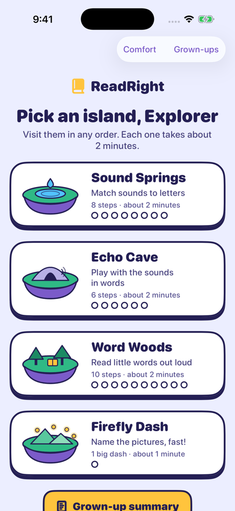
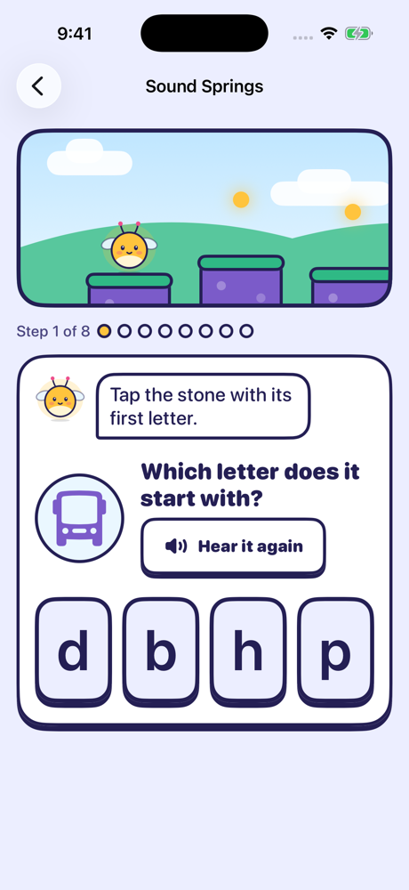
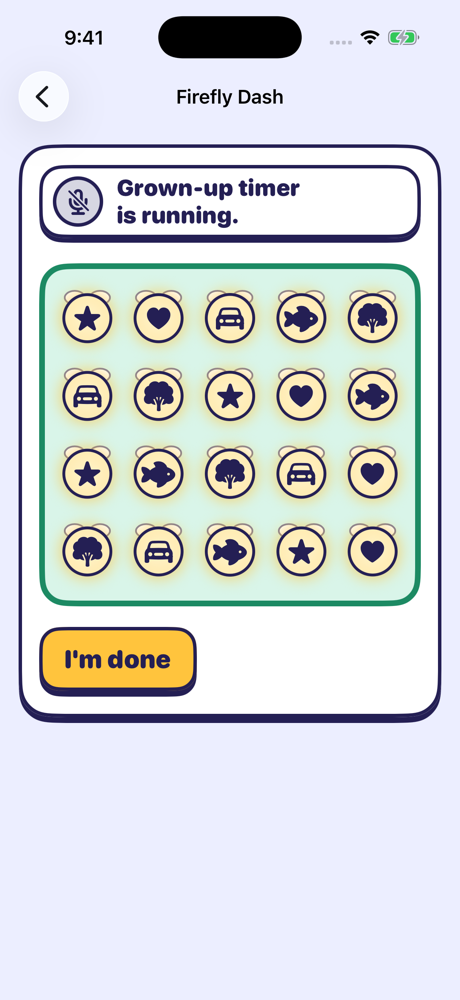
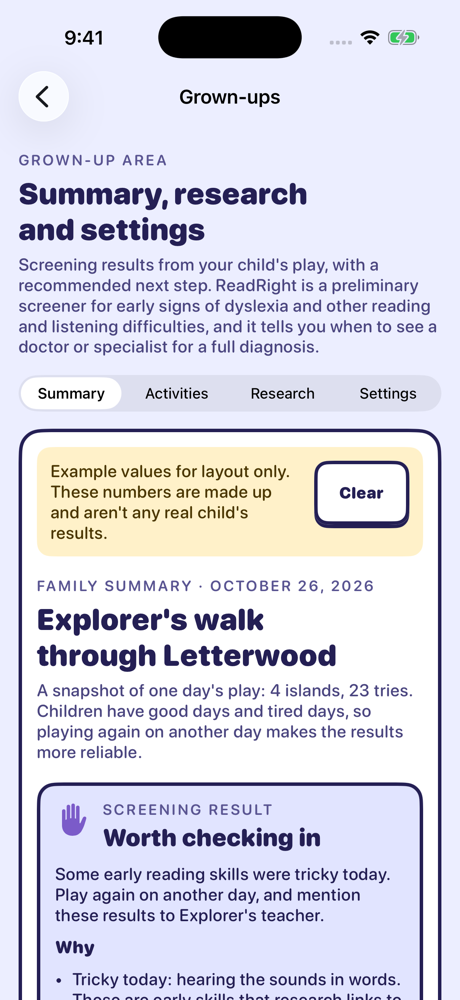

<p align="center">
  
  &nbsp;
  
</p>

<h1 align="center">ReadRight</h1>

<p align="center">
  A playful iPhone reading game, and a preliminary screener for early signs of dyslexia<br>
  and other reading and listening difficulties in children ages 5–8.
</p>

<p align="center">
  Built for the 2026 Congressional App Challenge, California's 10th district.
</p>

<p align="center">
  
  
  
  
</p>

## Why

Reading difficulties like dyslexia are often noticed late, after a child has already fallen behind and started to feel "bad at reading." Yet the early skills that predict them, such as hearing the sounds inside words and naming familiar things quickly, can be observed in kindergarten. ReadRight turns those observations into a short game that a family can play at home. It then gives a clear recommendation for when to talk to a teacher, doctor or dyslexia specialist.

## How it works

Children walk through Letterwood with **Pip**, a friendly firefly, and visit four islands. Every try lights a firefly. There are no lives, no timers on screen, and no red X's. Each island observes skills that reading research links to dyslexia:

| Island | What the child does | Skill it observes | What's measured |
|---|---|---|---|
| **Sound Springs** | Sees a picture, hears its word, and taps the first letter (4 choices) | Letter–sound knowledge | First-try match, mirror-image (b/d) or sound-alike (b/p) mix-ups, time to first tap |
| **Echo Cave** | After two practice puzzles, says words without their first sound (snail → nail) | Phonemic awareness | Time from the green light to the answer, on-device word check, single sounds vs. blends |
| **Word Woods** | Reads real words and made-up "creature names" (zib, vog) | Word reading and decoding | Time to start reading, word check for real words, a grown-up's marks for made-up words |
| **Firefly Dash** | Names 20 pictures (ages 5–6) or letters (ages 7–8) as fast as possible | Rapid automatized naming (RAN) | Time to the first name, total naming time, whether all 20 were named |

### A traffic light for talking

Every speaking item works like a traffic light, so a child always knows when to talk:

1. **Amber, "Get ready…"**: the microphone measures the room's background noise while the word is hidden.
2. **Green, "Your turn!"**: the word appears and timing starts at that exact moment.
3. **Pulsing green, "I hear you!"**: a voice was detected.

Voice-onset times come from 10 ms loudness windows timestamped by the audio hardware. Whether the word was right comes from Apple's on-device speech recognizer. See [How ReadRight listens](docs/HOW-THE-AUDIO-WORKS.md).

### The family summary

Behind a grown-up gate, each summary opens with a **screening result**:

- **Recommended: talk to a specialist**: two or more early skills were tricky, one was tricky on more than one day, or one was tricky and reading difficulties run in the family.
- **Worth checking in**: one skill was tricky, or several were mixed.
- **No signs that need follow-up today**

It explains why, and who to see: a teacher or school psychologist, a pediatrician, a dyslexia specialist, and a hearing check or speech-language pathologist when the listening results or background call for it. Below that is an "At a glance" table, then a card for each skill with a bar per item compared with the child's own middle time. It also lists patterns that happened at least twice, and has a **Share** button for sending the results to a doctor or specialist. Every rule is plain Swift in [`SummaryBuilder.swift`](ReadRight/Grownups/SummaryBuilder.swift) that a teacher or judge can read. There's no machine learning and no hidden score.

## Privacy by design

- **Nothing leaves the phone** unless a grown-up taps Share. There are no accounts, servers, analytics or third-party code.
- **Speech recognition is on-device only.** The app checks that the iPhone supports it before every request, and there's no server fallback. Made-up words are never sent to the recognizer at all.
- **A child's voice is never recorded or saved.** Microphone audio is measured in memory and thrown away. The microphone is on only while a listening round runs.
- **Data at rest** is encrypted while the phone is locked, kept out of iCloud backups, deleted after 90 days, and erasable any time.
- **Everything starts off.** A parent turns on the notebook and listening during setup, and a grown-up gate protects the summary and settings.

## Research behind it

ReadRight's activities follow what the International Dyslexia Association says an early screener should cover. They match the skills California public schools now screen for in kindergarten through 2nd grade (Education Code 53008). Key sources, all summarized in the app's Research tab:

- Melby-Lervåg, Lyster & Hulme (2012), *Psychological Bulletin*: phonemic awareness is strongly linked to word reading.
- Snowling & Melby-Lervåg (2016), *Psychological Bulletin*: family risk of dyslexia, and early differences in letter knowledge and rapid naming.
- A meta-analysis of rapid automatized naming and reading (137 studies).
- A meta-analysis of the made-up word (nonword) reading deficit in specific reading disorder.
- International Dyslexia Association: the definition of dyslexia, and universal K–2 screening guidance.
- Rello et al. (2020), *PLOS ONE*: why game-based screeners must be validated before making accuracy claims.

## Build and run

**Requirements:** Xcode 26 or later, iOS 17 or later.

1. Open `ReadRight.xcodeproj` and press ⌘R to run in the Simulator. Voice timing works with the Mac's microphone. Apple's speech recognizer usually doesn't work in the Simulator, so the word check falls back to timing only.
2. To run on an iPhone (needed for the on-device word check), set your Team under **Signing & Capabilities**. Change the bundle ID if it's taken, then turn on Developer Mode on the iPhone.
3. Press ⌘U to run the unit tests. They cover the voice-onset detector and traffic light, loudness math, word matching, item lists, Echo Cave practice, the voice-recording catalog, the data store, the grown-up gate, and the summary and referral rules.

**Testing flags** (Product → Scheme → Edit Scheme → Arguments):
- `-skipSetup`: skip the grown-up setup.
- `-screen <name>`: open a screen directly (`soundSprings`, `echoCave`, `wordWoods`, `fireflyDash`, `grownUps`, `lab`, `log`, `voice`, `studio`, `privacy`).
- `-silent`: mute Pip.
- `-autostart`: skip game intros.
- `-sampleSummary`: show a labeled example summary.
- `-gate`: open the grown-up gate.

**Pip's voice:** in Grown-ups → Settings → **Record Pip's voice**, a person can record every line Pip says. Recorded lines replace the iPhone voice one at a time. Recordings appear in Files → ReadRight → PipVoice. Copy that folder into `ReadRight/PipVoice/` to ship them inside the app.

**App icons:** Classic Pip and Retro Pip (pixel art). Switch between them in Grown-ups → Settings → **App icon**.

## Project structure

```
ReadRight/
  App/        App entry, navigation, theme, comfort settings, every line Pip says
  Audio/      Listening engine, voice-onset detector, on-device speech check,
              read-aloud trial (the traffic light), Pip's voice and recordings
  Games/      Sound Springs, Echo Cave and Word Woods (one shared engine), Firefly Dash, item lists
  Models/     Observations and the grown-up's profile, stored on device
  World/      Welcome and setup, island map, Pip, the hopping path, island art
  Grownups/   Grown-up gate, family summary and referral rules, research, privacy,
              settings, voice picker, Voice Studio, Listening Lab
ReadRightTests/
docs/         How ReadRight listens, screenshots
```

## Team, and how AI was used

ReadRight was made by two high-school students in California's 10th congressional district. As the Congressional App Challenge rules require, all AI use is disclosed here.

| Part | Made by |
|---|---|
| Choosing the idea (from options Claude suggested), deciding what to build, directing every feature and design change, reviewing and testing | The team |
| First web prototype (look, Pip, path, islands, summary layout) | The team, with Claude (claude.ai) |
| Swift code: audio engine, games, summary and referral rules, privacy and settings screens, tests, Xcode project, app icons | Claude Code (Anthropic's Claude Opus 5.5), directed and reviewed by the team |
| Research gathering and security reviews | Claude Code subagents, checked by the team |

**AI-use log**
- **Oct 25, 2026:** brainstormed the idea and built a web prototype with Claude (claude.ai).
- **Oct 25:** with Claude Code, researched the Challenge rules and past CA-10 winners and planned the build. Built the audio engine, the games and the data store. Ran automated code and security reviews and fixed what they found.
- **Oct 25:** redesigned the app from the prototype. Added the traffic light, Echo Cave, made-up words, the family summary, the research tab, and the voice picker and Voice Studio. Researched dyslexia indicators with sources.
- **Oct 25:** replaced Pip with a gentler firefly design. Switched Firefly Dash from colors to pictures and letters, added Echo Cave practice, and added the "At a glance" summary.
- **Oct 26:** added the screening result and referral, the grown-up gate and the privacy page. Ran a security check against the Challenge rules, made the app icons, and prepared this repository.

## Limitations and next steps

- **Not yet validated.** The games haven't been tested against professional assessments, so ReadRight recommends next steps but doesn't estimate how likely a condition is, and it has no age norms. The next step is a small pilot comparing results with school screening results, with families' consent.
- **English only.** Word lists should be reviewed by a reading specialist.
- **Speech recognition is less reliable for children.** That's why a mismatch counts as "unclear," never "wrong," and a grown-up can override it.
- **More to add:** letter-name knowledge for kindergartners, spelling for ages 7–8, and a second Firefly Dash per visit.

## License

All rights reserved. The source is shared for Congressional App Challenge judging and for learning. Please don't redistribute it.
